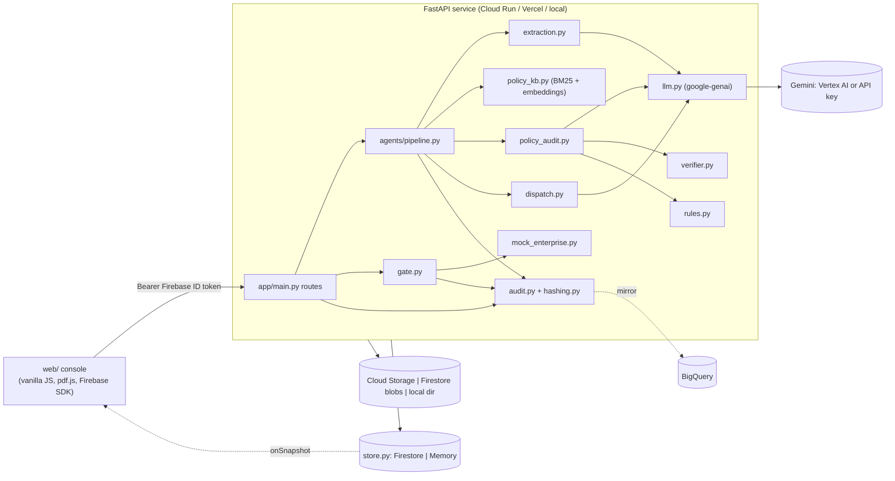

# OperateGuard AI developer guide

This guide explains how the system works end to end: the use cases, the request flow, every module, the data contracts, the decision rules, the API, the frontend, storage, configuration, testing and how to extend it. Read [README.md](README.md) for the pitch and [DECISIONS.md](DECISIONS.md) for why the build differs from the original brief.

---

## 1. What the system does

**Problem.** Procurement, legal and shared-services analysts read vendor documents, check each term against policy, and type entries into ERP and ticketing tools. This is slow, and the most expensive misses (for example, unlimited liability on page 9 of 15) are the easiest to overlook.

**Solution.** A pipeline of AI agents plus deterministic code that:
1. **Extracts** 12 key terms from a PDF with page-cited, verified quotes.
2. **Audits** each term against policy text **retrieved** in the same run, never from model memory.
3. **Decides** severity, risk score, routing and tasks **in code**.
4. **Drafts** ERP/Jira actions and an approver rationale.
5. **Waits for a human.** Only the approval gate can write to (mock) enterprise systems.
6. **Audits everything** in a SHA-256 hash chain.

### Use cases
| # | Actor | Use case | Outcome |
|---|---|---|---|
| UC1 | Analyst | Analyse a vendor SOW/contract/invoice | Extracted terms, grounded findings, risk, draft actions |
| UC2 | Analyst | Find a buried critical clause | Clause highlighted on its page, CRITICAL finding with policy citation |
| UC3 | Approver | Approve and execute | Mock ERP PO + approval request + Jira tickets created; decision audited |
| UC4 | Approver | Edit before approval (negotiated terms, severity override) | Risk and routing recomputed by rules; edit audited |
| UC5 | Approver | Reject | No external writes; decision audited |
| UC6 | Auditor | Verify integrity | Hash chain recomputed; tampering detected |
| UC7 | Security | Document contains prompt injection | Reported as data, `EMBEDDED_INSTRUCTIONS` finding, escalated |
| UC8 | Analyst | Incomplete / scanned / foreign-currency / invoice documents | Missing fields listed (not guessed), scans read visually, FX-converted approval band, invoice-specific checks |

---

## 2. Design invariants (do not break these)

| ID | Invariant | Enforced by |
|---|---|---|
| D1 | **Agents propose, humans dispose.** `app/agents/*` never imports `gate` or `mock_enterprise`. | `tests/test_safety.py::test_agents_cannot_import_gate_or_mock` (AST scan) |
| D1 | Writes happen only after an atomic `PROPOSED → APPROVED` transition; approving twice returns 409. | `app/state.py`, `app/store.py::transition`, safety tests |
| D2 | **Grounded or silent.** A finding's policy snippet must be a verbatim quote of a snippet retrieved in this run for that category. | `app/agents/verifier.py` |
| D3 | **Code decides.** Severity, score, status, action, route and tasks come from `rules.py`. The LLM writes text only. | `app/agents/rules.py`, LLM schemas have no decision fields |
| D4 | **Strict contracts.** Every LLM output is validated by Pydantic; invalid output gets one retry, then the case is `FAILED`. | `app/agents/llm.py::generate_json` |
| D5 | **Tamper-evident audit.** `row_hash = sha256(prev_hash + canonical_json(row))`. | `app/hashing.py`, `app/audit.py` |
| D6 | **Honest numbers.** Confidence is computed, data is labelled synthetic, benchmarks come only from `eval/run_eval.py`. | `extraction.py`, `eval/` |

---

## 3. Architecture



### Tech stack
| Layer | Choice |
|---|---|
| Backend | Python 3.11+, FastAPI, Pydantic v2, uvicorn |
| AI | `google-genai` SDK → Gemini `gemini-3.5-flash` (Vertex AI or API key), `gemini-embedding-001` |
| PDF | `pypdf` (text layer for quote verification), pdf.js (browser rendering) |
| State | Cloud Firestore (prod) / in-memory (local, tests) |
| Auth | Firebase Authentication (anonymous + Google), `firebase-admin` token verification |
| Frontend | Static HTML/CSS/JS, no build step |
| Hosting | Cloud Run + Firebase Hosting (`infra/deploy.sh`), or Vercel (`vercel.json`) |

---

## 4. Repository map

```
app/
  main.py              FastAPI app: routes, ownership checks, rate limit, static mount
  config.py            Settings from env; service-account bootstrap; public config for the UI
  schemas.py           All Pydantic contracts (LLM shapes + domain shapes + enums)
  state.py             Case state machine (only place transitions are defined)
  store.py             Store interface, MemoryStore, FirestoreStore, BlobStore
  auth.py              Firebase ID token verification / demo user
  gate.py              Approve / edit / reject (the only writer to enterprise systems)
  mock_enterprise.py   Mock ERP + Jira (in-process, or a remote service via MOCK_SERVICE_URL)
  audit.py             Append hash-chained rows, BigQuery mirror, verify (+ tamper simulation)
  hashing.py           canonical_json, row_hash, verify_chain
  agents/
    pipeline.py        Orchestrator + Tracer (fixed order)
    extraction.py      Agent 1: Gemini PDF extraction + quote verification + confidence
    policy_kb.py       Policy index: BM25 + optional Gemini embeddings
    policy_audit.py    Agent 2: retrieval per category, Gemini comparison, verifier, guards
    verifier.py        Citation verifier
    rules.py           Deterministic decisions: guards, severity, score, route, tasks, edits
    dispatch.py        Agent 3 (rationale + ticket text) and Supervisor (summary)
    llm.py             Gemini client: structured output, retry, model fallback, embeddings
    pdftext.py         PDF text extraction and fuzzy quote location
api/index.py           Vercel entrypoint (imports app.main:app)
web/                   index.html, app.js, styles.css
data/
  generate_data.py     Builds every synthetic PDF + corpus.json + ground truth
  policies/            4 policy PDFs + corpus.json (28 sections = retrieval units)
  demo_docs/           10 vendor PDFs + catalog.json (UI sample list)
  ground_truth/        Expected extraction + routing per document (eval and tests)
infra/                 deploy.sh (Cloud Run + Firebase), firestore.rules, bq_schema.json
eval/run_eval.py       Benchmarks against a running deployment
tests/                 conftest.py (FakeLLM), test_units.py, test_safety.py, ui_harness.py
scripts/               capture_screenshots.py (Playwright)
submission/            Description, deck content, video script
```

---

## 5. End-to-end flow

```mermaid
sequenceDiagram
  participant U as Browser
  participant A as API (main.py)
  participant P as pipeline.py
  participant G as Gemini
  participant S as Firestore
  U->>A: POST /api/cases {sample} or /api/cases/upload (PDF)
  A->>S: create case (UPLOADED)
  U->>A: POST /api/cases/{id}/process
  A->>S: transition → PROCESSING
  A->>P: run(case)
  P->>G: Extraction (PDF + schema)
  P->>S: trace events, audit row, extraction
  P->>P: retrieve policy per category (parallel)
  P->>G: Policy audit (terms + snippets)
  P->>P: verifier → guards → rules.decide
  P->>S: trace, audit row, audit result
  P->>G: Dispatch + Supervisor (parallel)
  P->>S: audit row; transition → PROPOSED (proposal)
  S-->>U: onSnapshot: case + trace (or the UI polls GET /api/cases/{id})
  U->>A: POST /api/cases/{id}/approve
  A->>S: transition PROPOSED→APPROVED (atomic), decision, audit row
  A->>A: mock ERP/Jira execute tasks
  A->>S: audit row (EXECUTION), transition → EXECUTED
  U->>A: GET /api/cases/{id}/audit/verify
```

The pipeline runs **inside the `/process` request**, so it works on serverless hosts. The UI follows progress through Firestore listeners or polling, so a proxy timeout does not lose state.

---

## 6. The pipeline in detail (`app/agents/pipeline.py`)

The `Tracer` writes `cases/{id}/trace/{eventId}` documents `{ts, seq, agent, step, message, payload, ownerUid}` after every step. Stage latencies are stored in `case.latencyMs`.

### 6.1 Agent 1: Extraction (`extraction.py`)
- **Input:** raw PDF bytes (multimodal `Part.from_bytes`) plus a system prompt that treats the document as **data** and asks for `suspicious_instructions`.
- **Output schema:** `ExtractionLLM`: 12 key fields, `evidence[] {field, value, page, quote}`, `missing_fields`, `suspicious_instructions`.
- **Post-processing in code (`build_result`):**
  - `liability_cap` normalised to `UNLIMITED` or `<n>x_ANNUAL_FEES`.
  - Each quote is located with `pdftext.locate_quote` (exact normalised substring, or ≥80% of 4-word shingles) on the cited page, then on all pages. Sets `verified` and corrects `page`.
  - `extraction_confidence` = verified quotes ÷ quotes. Quotes on pages without a text layer (scans) count 0.5.
  - `missing_fields` = model list ∪ null key fields (notice days are only expected when auto-renewal is true).
- **Key fields:** `document_type, vendor_name, vendor_country, total_value, currency, payment_terms_days, milestone_billing, liability_cap, governing_law, warranty_period_days, auto_renewal, auto_renewal_notice_days`.

### 6.2 Retrieval (`policy_kb.py`)
- **Corpus:** `data/policies/corpus.json`, one entry per policy section: `{retrieval_id, source_file, policy_title, owner, page, section, heading, text}`.
- **Query per category:** `CATEGORY_META[cat].query + extracted term`. All categories run concurrently.
- **Scoring:** BM25 normalised to [0,1]. If embeddings work, the score is `0.5·bm25 + 0.5·cosine`. On any embedding error it falls back to BM25 permanently for that process. It returns the top 3 snippets.

### 6.3 Agent 2: Policy Audit (`policy_audit.py`)
1. `applicable_categories`:
   - **SOW/contract:** LIABILITY_CAP, PAYMENT_TERMS, AUTO_RENEWAL, WARRANTY, GOVERNING_LAW, SPEND_APPROVAL.
   - **Invoice:** PAYMENT_TERMS, SPEND_APPROVAL.
   - Add EMBEDDED_INSTRUCTIONS if injection text was found.
2. Categories whose term is **missing** never go to the model.
3. One Gemini call with `[{category, contract_term, contract_quote, policy_snippets[]}]` → `AuditLLM.findings[]`.
4. **Verifier** (`verifier.py`) rejects a finding if: unknown category; category not audited; duplicate; `retrieval_id` not retrieved for that category in this run; snippet under 12 characters; or snippet not a normalised verbatim substring. Rejections go to the trace and to `audit.rejected_findings`.
5. **`rules.finalize`** merges the model judgement with the deterministic **guard**:

| Model says | Guard says | Result |
|---|---|---|
| no verified finding | — | violation = guard result, `needs_review`, note "No verified policy citation" |
| compliant | violation | **violation**, `needs_review`, "Deterministic guard override" |
| violation | compliant | violation kept, `needs_review`, "Model flagged… kept for human review" |
| agree | agree | as agreed |
| term missing | — | LOW, `needs_review`, "Term not found" |

6. A `Finding` is built per category with `finding_id = "F-<CATEGORY>"`, the contract quote/page, policy source `"<file>, Section x (p.n)"`, snippet, severity and owner group.

### 6.4 Rules (`rules.py`), all deterministic
**Guard thresholds** (mirroring the synthetic policies):
| Category | Violation when | Severity | Owner |
|---|---|---|---|
| LIABILITY_CAP | `UNLIMITED` or multiple > 1.0x | CRITICAL | Legal Operations |
| PAYMENT_TERMS | days < 45 | MODERATE | Treasury |
| AUTO_RENEWAL | auto-renews and notice missing or < 60 days | HIGH | Legal Operations |
| WARRANTY | days < 90 | MODERATE | Legal Operations |
| GOVERNING_LAW | not Delaware / New York / England | LOW | Legal Operations |
| EMBEDDED_INSTRUCTIONS | any injection text | HIGH | Legal Operations |
| SPEND_APPROVAL | never (approval band only) | NONE | Procurement |

**Score:** sum of weights over *active* findings (severity ≠ NONE and violation or review): CRITICAL 45, HIGH 30, MODERATE 20, LOW 5, capped at 100.
**Risk level:** any CRITICAL → `CRITICAL`; otherwise ≥45 `HIGH`, ≥15 `MEDIUM`, else `LOW`.
**Overall status:** any violation → `FLAGGED_FOR_EXCEPTION`; review items only → `NEEDS_REVIEW`; else `COMPLIANT`.
**Recommended action:**
1. A Legal-owned violation of HIGH or above → `ROUTE_TO_LEGAL_AND_VP_APPROVAL`
2. else any Legal-owned active item → `ROUTE_TO_LEGAL_REVIEW`
3. else any Treasury item → `ROUTE_TO_TREASURY`
4. else → `APPROVE_AND_STAGE`

**Approval route:** spend band on the USD-converted value (`FX_TO_USD`: EUR 1.08, GBP 1.27…). Under 50k → Cost-centre Manager; 50k-100k → Director; over 100k → Vice President + Legal Operations. The action then adds approvers (VP/Legal, Legal, or Treasury Manager). An unknown value → Director.
**Tasks:**
- `T1`: MOCK_ERP `STAGE_PURCHASE_ORDER` (or `STAGE_INVOICE_FOR_PAYMENT`), status `READY_TO_POST` or `BLOCKED_ON_EXCEPTION`
- `T2`: MOCK_ERP `REQUEST_APPROVAL` with the route
- `T3+`: one MOCK_JIRA `CREATE_EXCEPTION_TICKET` per owner group with active findings; priority from the highest severity

### 6.5 Agent 3: Dispatch + Supervisor (`dispatch.py`)
Two concurrent Gemini calls receive the already-decided facts. `DispatchLLM` returns the rationale and `tickets[{assigned_group, summary, description}]`; `SupervisorLLM` returns `case_summary`. The ticket texts are merged into the rule-built tasks by group. Unknown groups are ignored, and missing text falls back to a deterministic default. The final `ActionProposal` is re-validated before storage.

### 6.6 Expected routing for the bundled documents
| Doc | Action | Risk level |
|---|---|---|
| A | APPROVE_AND_STAGE | LOW |
| B | ROUTE_TO_TREASURY | MEDIUM |
| C | ROUTE_TO_LEGAL_AND_VP_APPROVAL | CRITICAL |
| D | ROUTE_TO_LEGAL_REVIEW | LOW |
| E, F, H | ROUTE_TO_TREASURY | MEDIUM |
| G | APPROVE_AND_STAGE | LOW |
| I, J | ROUTE_TO_LEGAL_AND_VP_APPROVAL | CRITICAL |

(Asserted in `tests/test_units.py::test_rules_route_every_ground_truth_document`.)

---

## 7. State machine (`app/state.py`)

```
UPLOADED ──► PROCESSING ──► PROPOSED ──► APPROVED ──► EXECUTED
                 │             │  ▲
                 │             │  └── edit (PROPOSED → PROPOSED)
                 │             └────► REJECTED
                 └──► FAILED ──► PROCESSING (retry)
```
`ALLOWED[to] = {from…}`. `store.transition(case_id, allowed_from, to)` is a compare-and-set (a Firestore transaction or a lock), raising `ConflictError` → HTTP 409.

---

## 8. Human gate (`app/gate.py`)
- **approve:** transition to `APPROVED` (atomic) → decision doc → audit `HUMAN_DECISION` → execute each task via `MockEnterprise.execute` → audit `EXECUTION` → transition to `EXECUTED` with `execution` results.
- **edit (`EditRequest`):** `payment_terms_days` re-runs the payment guard; `severity_overrides {finding_id: severity}` (`NONE` waives). `rules.apply_edits` recomputes everything and keeps the ticket texts; the edit (before/after) is appended to `proposal.edits`, a decision and an audit row.
- **reject:** transition to `REJECTED`, decision, audit. No external calls.

---

## 9. Audit chain (`app/audit.py`, `app/hashing.py`)
- **Row:** `{event_id, case_id, event_type (AGENT_RUN|HUMAN_DECISION|EXECUTION), actor, payload, ts, seq, prev_hash, row_hash}`.
- **Hash:** `row_hash = sha256(prev_hash + canonical_json(row without row_hash))`, with sorted keys and no whitespace. The first row uses `prev_hash = "GENESIS"`.
- **Atomic append:** a Firestore transaction writes `cases/{id}/audit/{seq:05d}` and updates `case.lastAuditHash` and `case.auditRows`.
- **Verify:** recomputes the chain and also checks that the head equals `case.lastAuditHash`. `?simulate_tamper=N` alters an in-memory **copy** only.
- **Payloads:** model ID, system-prompt SHA, retrieval and citations, the proposal, the human identity and the execution results.
- **BigQuery mirror:** best-effort when `BQ_AUDIT_TABLE` is set.
- **Typical executed case:** 5 rows (Extraction, PolicyAudit, ActionDispatch, decision, execution).

---

## 10. Storage (`app/store.py`)

| Path | Contents | Client access |
|---|---|---|
| `cases/{id}` | status, ownerUid, filename, documentUri, extraction, audit, proposal, riskScore, riskLevel, recommendedAction, summary, latencyMs, lastAuditHash, auditRows | owner read |
| `cases/{id}/trace/{eventId}` | live trace | owner read (via parent `get()` in rules) |
| `cases/{id}/decisions/{id}` | human decisions | server only |
| `cases/{id}/audit/{seq}` | hash chain | server only |
| `mock_erp/{id}`, `mock_jira/{id}` | mock enterprise records | server only |
| `blobs/{key}` + `chunks/{i}` | uploaded PDFs when there is no GCS bucket (Vercel) | server only |

**Document URIs:**
- `sample://file.pdf`: a bundled demo document
- `gs://bucket/key`: Cloud Storage
- `fsblob://key`: Firestore chunks of 900 KB
- `file://key`: local folder

**Backend selection:**
- `STORE_BACKEND` defaults to `firestore` when a project is known, otherwise `memory`.
- `MemoryStore` is process-local; use it only for local work and tests.

---

## 11. API reference (`app/main.py`)
All `/api/cases*` routes need `Authorization: Bearer <Firebase ID token>` when `AUTH_MODE=firebase`. Cases are scoped to `ownerUid`; anyone else gets 404.

| Method | Path | Purpose |
|---|---|---|
| GET | `/healthz` | `{ok, store, auth, gemini, warnings}` |
| GET | `/api/config` | Public UI config (auth mode, Firebase web config, realtime, models, limits, warnings) |
| GET | `/api/samples` · `/api/samples/{key}/pdf` | Demo catalogue / PDF |
| GET | `/api/policies` · `/api/policies/{file}.pdf` | Policy corpus / policy PDF |
| POST | `/api/cases` `{sample}` | Create a case from a demo document |
| POST | `/api/cases/upload` (multipart `file`) | Upload a PDF (magic-byte and size checked) |
| POST | `/api/cases/{id}/process` | Run the pipeline (409 unless UPLOADED/FAILED; 429 when over the rate limit) |
| GET | `/api/cases` · `/api/cases/{id}` | Queue / full case with trace and decisions |
| GET | `/api/cases/{id}/document` | The case PDF |
| POST | `/api/cases/{id}/approve` · `/reject` `{note}` | Gate decisions (409 if not PROPOSED) |
| POST | `/api/cases/{id}/edit` `EditRequest` | Analyst overrides (400 for an unknown finding) |
| GET | `/api/cases/{id}/audit` · `/audit/verify?simulate_tamper=N` | Audit rows / verification |
| GET | `/api/cases/{id}/mock-status` | `{erp:[…], jira:[…]}` |

Interactive docs: `/api/docs` (Swagger).

---

## 12. Frontend (`web/app.js`)
- **Boot:** `GET /api/config`. If `authMode=firebase`, it loads the Firebase JS SDK from gstatic, signs in (anonymous or Google) and attaches the ID token to every call. Otherwise it uses the shared demo user.
- **Routing:** `#/` (home: samples, upload, queue polled every 4 s) and `#/case/{id}` (workspace).
- **Live updates:**
  - With `realtime` on, it uses `onSnapshot` on `cases/{id}` and `cases/{id}/trace` (ordered by `ts`).
  - Otherwise it polls `GET /api/cases/{id}` every second while the case is processing.
  - If a listener fails, it falls back to polling.
- **Rendering:** `render()` re-draws only when a signature (status, counts, timestamps) changes. All user and document text goes through `esc()` (XSS-safe, important for injected document text).
- **PDF:** pdf.js renders pages to canvas. Highlights come from matching the normalised evidence quote against concatenated text items, then drawing rectangles from item transforms. The colour is the severity of the related finding.
- **Gate UI:** confirmation modal → approve; the edit modal builds an `EditRequest`; verify and tamper call the audit endpoints.

---

## 13. Configuration (env vars, `app/config.py`)
| Variable | Default | Purpose |
|---|---|---|
| `GEMINI_API_KEY` | — | Use the Gemini API (otherwise Vertex AI via ADC) |
| `GOOGLE_GENAI_USE_VERTEXAI` | true if no API key | Force Vertex AI |
| `GOOGLE_CLOUD_PROJECT` | — | Project; enables Firestore by default |
| `GCP_SERVICE_ACCOUNT_JSON` | — | Raw or base64 key → written to a temp file and set as `GOOGLE_APPLICATION_CREDENTIALS` |
| `GEMINI_FLASH_MODEL` / `GEMINI_AUDIT_MODEL` | `gemini-3.5-flash` | Model IDs |
| `GEMINI_MODEL_FALLBACKS` | `gemini-3.8-flash,gemini-3.5-flash-lite,gemini-flash-latest` | Tried if a model is unavailable |
| `GEMINI_LOCATION` | `global` | Vertex location |
| `GEMINI_THINKING_LEVEL` | `low` | Empty disables the thinking config |
| `EMBEDDING_MODEL` / `USE_EMBEDDINGS` | `gemini-embedding-001` / true | Hybrid retrieval |
| `STORE_BACKEND` | firestore if project else memory | Persistence |
| `AUTH_MODE` | firebase if `FIREBASE_WEB_CONFIG` else none | none = shared demo user |
| `FIREBASE_WEB_CONFIG` | — | Web SDK config JSON |
| `GCS_BUCKET`, `BQ_AUDIT_TABLE` | — | Upload bucket, audit mirror |
| `MAX_UPLOAD_MB` | 15 (4 on Vercel) | Upload cap |
| `RUNS_PER_HOUR` | 40 (120 in demo mode) | Per-user rate limit |
| `MOCK_SERVICE_URL` | — | Call a separately deployed mock service with OIDC |

**LLM client behaviour (`llm.py`):**
- Retries 429/503 with backoff (4/8/15 s for rate limits).
- Drops `thinking_config` or `response_schema` if the model rejects them.
- Falls through the model fallbacks on "not found"-type errors.
- Remembers the model that worked.

---

## 14. Running, testing, evaluating

```powershell
python -m venv .venv; .\.venv\Scripts\Activate.ps1
pip install -r requirements-dev.txt

# real run (memory store, demo user)
$env:GEMINI_API_KEY="..."; python -m uvicorn app.main:app --reload --port 8080

# tests (offline, FakeLLM)
python -m pytest -q

# UI without Gemini (FakeLLM, local dev only)
python -m tests.ui_harness            # http://127.0.0.1:8090

# end-to-end browser run + screenshots
python scripts/capture_screenshots.py http://127.0.0.1:8090

# benchmarks against a deployment (writes eval/report.md, eval/results.json)
python eval/run_eval.py --base https://<site> [--firebase-api-key <apiKey>]

# regenerate synthetic data (PDFs, corpus, ground truth)
python data/generate_data.py
```

**Test suites:**
- `test_safety.py`: no writes before approval, idempotent approve, reject has no writes, audit tamper detection, 401 without a token, the agents' import boundary, owner isolation, fabricated citations dropped, guard beats a "compliant" model, invalid LLM output → FAILED and retry, edits re-scored, upload validation.
- `test_units.py`: hash chain, verifier, rules for all 10 documents, spend bands, cap normalisation, missing fields, LLM retry, blob chunking, service-account bootstrap.

`tests/conftest.py::FakeLLM` derives answers from `data/ground_truth`. It exists only for tests and the UI harness; never wire it into the live path.

---

## 15. Deployment targets
| Target | How | Notes |
|---|---|---|
| Cloud Run + Firebase Hosting | `bash infra/deploy.sh` (Cloud Shell) | Primary. Vertex AI via service account, GCS uploads, BigQuery mirror, min-instances 1 |
| Vercel | `vercel.json` + `api/index.py`; see `DEPLOY_VERCEL.md` | Firestore required; 4 MB uploads; 60 s function limit |
| Docker anywhere | `docker build -t og . && docker run -p 8080:8080 -e GEMINI_API_KEY=… og` | Memory store unless GCP vars are set |

---

## 16. Extending the system
| Task | Where / how |
|---|---|
| **Add or change a policy** | Edit `POLICIES` in `data/generate_data.py`, then run it (it rebuilds the PDFs and `corpus.json`). If a hard limit changes, update the matching constant in `rules.py` (guard values are commented with their retrieval IDs). |
| **Add a clause category** | 1) Add it to the `Category` enum. 2) Add `CATEGORY_META` (query, owner, severity). 3) Add `extracted_term`, `guard` and `EVIDENCE_FIELD` entries. 4) Add it to `applicable_categories`. 5) If it needs a new extracted field, add it to `ExtractionLLM`, the domain models, `build_result` and the extraction prompt. 6) Add ground truth and tests. |
| **Change routing or weights** | `WEIGHTS`, `score`, `recommend`, `SPEND_BANDS`, `approval_route` in `rules.py`. Update `expected_action` in the ground truth. |
| **Swap retrieval to Vertex AI Search** | Implement a `search(query, llm, k) -> (list[RetrievedSnippet], retriever_name)` with the same shape in `policy_kb.py`. The verifier contract (retrieval_id + verbatim snippet) stays the same. |
| **Use Document AI for extraction** | Replace the Gemini PDF part in `extraction.run` with Document AI text/entities, keeping `build_result` (quote verification and confidence) unchanged. |
| **Real ERP/Jira** | Implement `MockEnterprise.execute`-compatible connectors, or set `MOCK_SERVICE_URL` to a private service. Keep the calls inside `gate.py` only. |
| **New storage backend** | Implement the `Store` interface, including atomic `transition` and `append_audit`. |
| **New model** | Set `GEMINI_FLASH_MODEL` / `GEMINI_AUDIT_MODEL`; no code change. |

**Checklist before merging:** `python -m pytest -q` is green, the safety tests are untouched or strengthened, no new import from `app/agents` to `gate`/`mock_enterprise`, and the LLM schemas contain no decision fields.

---

## 17. Troubleshooting
| Symptom | Cause / fix |
|---|---|
| Case `FAILED: Gemini call failed: 400 API key not valid` | Wrong `GEMINI_API_KEY` |
| `module aiohttp has no attribute ClientConnectorDNSError` | Old aiohttp: `pip install "aiohttp>=3.10.11"` |
| UI "Setup needed" banner | See `/healthz` warnings (storage or Gemini not configured) |
| Live trace not streaming on the hosted site | Firestore rules not deployed or `FIREBASE_WEB_CONFIG` missing; the UI falls back to polling |
| Guest sign-in fails | Enable **Anonymous** in Firebase Authentication |
| Google sign-in fails on a custom domain | Add the domain to Firebase **Authorized domains** |
| Cases vanish between requests on Vercel | Memory store on serverless; set `GCP_SERVICE_ACCOUNT_JSON` |
| 429 errors / slow runs | Gemini quota; set `USE_EMBEDDINGS=false` or use Vertex AI |
| PDFs corrupted after a git checkout on Windows | `.gitattributes` marks `*.pdf binary`; re-clone if they were checked out before that commit |
