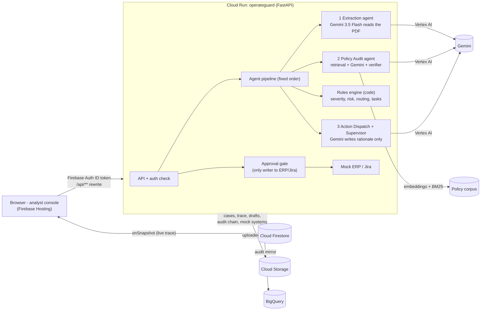

# OperateGuard AI

**An operations compliance copilot for procurement, legal and shared-services teams.**
An analyst uploads a vendor SOW, contract or invoice. Gemini extracts the key terms with page-cited quotes, every term is checked against the company's own policy text (retrieved, not remembered), and the system drafts the follow-up actions: an ERP staging entry, exception tickets, an approval route. **Nothing is written to any enterprise system until a human approves**, and every step, citation and sign-off goes into a tamper-evident, hash-chained audit trail.

> All documents, policies, companies and people in this repository are **synthetic demo data**.

**Guides:** [User guide](USER_GUIDE.md) for analysts and evaluators · [Developer guide](DEVELOPER_GUIDE.md) for the full flow, modules, rules, API and extension points · [Vercel deploy](DEPLOY_VERCEL.md)

| | |
|---|---|
| **Live prototype** | `https://<PROJECT_ID>.web.app` (Firebase Hosting) · `https://operateguard-<hash>-uc.a.run.app` (Cloud Run) · `https://<app>.vercel.app` (Vercel) |
| **Try it** | Open the link → **Continue as guest analyst** → **Analyze** document **C** |
| **Demo video** | `<link>` |

---

## What you will see (2 minutes)

1. **Document C** is a 15-page SOW (USD 145,000). The sentence *"Supplier liability shall be unlimited for all general operational claims"* is buried on **page 9**, under a harmless-sounding heading.
2. Click **Analyze**. The **live agent trace** streams from Firestore: Extraction → Policy Audit → Rules → Action Dispatch.
3. The **Document** panel highlights the evidence in the PDF; the **Reasoning** panel shows each contract clause **side by side** with the verbatim policy snippet it was checked against (e.g. *Global Procurement Policy v4.2, Section 8.3*), with severity.
4. The **Action gateway** shows the **UNCOMMITTED** draft: risk 100/100 (CRITICAL), *Route to Legal + VP approval*, a blocked ERP purchase order, a Legal Operations ticket and a Treasury ticket (Net 15).
5. **Approve and execute** → the mock ERP shows `BLOCKED_ON_EXCEPTION`, mock Jira tickets are opened, and **Verify audit chain** recomputes the SHA-256 chain. **Simulate tampering** shows the chain breaking.
6. Try **A** (clean → approve and stage), **B** (Net 15 → Treasury) and the 7 edge cases: missing fields, contradictory terms, a scanned page, EUR currency, an invoice, unusual "unlimited" wording, and a **prompt-injection attempt**.

## Architecture



**Case state machine** (enforced only in `app/state.py`):
`UPLOADED → PROCESSING → PROPOSED → APPROVED → EXECUTED`, with `PROPOSED → (edit) → PROPOSED`, `PROPOSED → REJECTED`, `PROCESSING → FAILED → PROCESSING`.

## How each Google service is used

| Service | Role in OperateGuard |
|---|---|
| **Gemini on Vertex AI** (`gemini-3.5-flash`, model ID from env with fallbacks) | Multimodal PDF extraction with verbatim, page-cited quotes (including scanned pages); policy reasoning restricted to retrieved snippets; approver rationale, ticket text and Supervisor case summary. Structured JSON output validated with Pydantic, one retry, then the case fails cleanly. |
| **Gemini embeddings** (`gemini-embedding-001`) | Semantic half of hybrid (BM25 + embedding) policy retrieval. Falls back to BM25 if unavailable. |
| **Cloud Run** | Hosts the FastAPI API, the agent pipeline, the human approval gate, the mock ERP/Jira and the static console. `min-instances=1`, no CPU throttling, dedicated least-privilege service account. |
| **Cloud Firestore** | Case state, extraction/audit/proposal drafts, **live agent trace** (browser `onSnapshot` listeners, no WebSocket code), human decisions, the **hash-chained audit rows**, and the mock enterprise records. Security rules: owners can read their own cases and traces; all client writes are denied. |
| **Firebase Authentication** | Analyst identity (one-click **guest/anonymous** sign-in for evaluators, Google sign-in). Every API call carries a Firebase ID token verified server-side; the approver's identity is written into the audit chain. |
| **Firebase Hosting** | Serves the console on a global CDN and rewrites `/api/**` to Cloud Run (same origin, no CORS). |
| **Cloud Storage** | Uploaded PDFs (`inbound/`). |
| **BigQuery** | Append-only analytics mirror of every audit row (`operateguard.audit_log`). |

## Design principles (and where they live in code)

| Principle | Implementation |
|---|---|
| **Agents propose, humans dispose** | `app/agents/*` cannot import the gate or mock systems (enforced by `tests/test_safety.py::test_agents_cannot_import_gate_or_mock`). Only `app/gate.py` writes, and only after an atomic `PROPOSED → APPROVED` transition; a second approve returns **409**. |
| **Grounded or silent** | `app/agents/verifier.py` drops any finding whose `policy_snippet` is not a verbatim quote of a snippet retrieved **in this run** for that category. |
| **Deterministic where it matters** | `app/agents/rules.py` computes severity, risk score, status, recommended action, approval route and the task list. **Guards** mirror hard policy limits, so the model can add a concern but can never talk a breach away (see doc J). |
| **Strict contracts** | `app/schemas.py`: LLM-facing schemas contain only text the model may author; domain schemas are validated at every handoff. |
| **Tamper-evident audit** | `app/hashing.py`: `row_hash = sha256(prev_hash + canonical_json(row))`, `GENESIS` first. `GET /api/cases/{id}/audit/verify` recomputes it. |
| **Honest by construction** | Synthetic data labelled everywhere; extraction confidence = share of quotes verified on the PDF text layer (computed, not asked of the model); benchmark numbers come only from `eval/run_eval.py`. |
| **Prompt-injection resistant** | The extraction prompt treats documents as data and reports embedded instructions; rules add an `EMBEDDED_INSTRUCTIONS` finding grounded in *Legal Contract Standards §5*. |

## Run it

### Option 1: deploy to Google Cloud (about 10 minutes, from Cloud Shell)
```bash
git clone https://github.com/<you>/operateguard.git && cd operateguard
export PROJECT_ID=<your-project-with-billing>  REGION=us-central1
firebase login --no-localhost        # once, for Firestore rules + Hosting
bash infra/deploy.sh
```
The script enables the APIs, adds Firebase to the project, creates Firestore, the bucket, the BigQuery table, a least-privilege service account and a Firebase web app, enables anonymous sign-in, deploys Cloud Run from source, then deploys Firestore rules and Hosting. If anonymous sign-in cannot be enabled automatically, enable it in *Firebase console → Authentication → Sign-in method* and re-run.

### Option 2: deploy to Vercel (about 10 minutes, no gcloud needed)
[](https://vercel.com/new/clone?repository-url=https://github.com/<you>/operateguard&env=GEMINI_API_KEY,GCP_SERVICE_ACCOUNT_JSON&envDescription=Gemini%20API%20key%20and%20base64%20Firebase%20service-account%20key&envLink=https://github.com/<you>/operateguard/blob/main/DEPLOY_VERCEL.md)

Create a Firestore database, download a service-account key, get a Gemini API key, then set `GEMINI_API_KEY` and `GCP_SERVICE_ACCOUNT_JSON` on Vercel. `FIREBASE_WEB_CONFIG` is optional and adds sign-in and live listeners. Step-by-step: **[DEPLOY_VERCEL.md](DEPLOY_VERCEL.md)**.

### Option 3: run locally with a Gemini API key
```bash
pip install -r requirements.txt
export GEMINI_API_KEY=<key from aistudio.google.com>    # memory store, no login, real Gemini
uvicorn app.main:app --port 8080                         # open http://localhost:8080
```

### Tests (offline)
```bash
pip install -r requirements-dev.txt
python -m pytest -q          # 34 tests: safety suite, verifier, rules for all 10 docs, hash chain, retries
```
Tests use `tests/conftest.py::FakeLLM` (answers derived from ground truth) so the deterministic layers can be tested without network access. It is never used by the running service.

### Evaluation (against a running deployment)
```bash
python eval/run_eval.py --base https://<PROJECT_ID>.web.app --firebase-api-key <web apiKey>
```
Writes `eval/report.md` and `eval/results.json`: latency p50/p95, 12-entity extraction accuracy, routing accuracy, citation fidelity, gate-safety checks and audit verification.

## Repository layout
```
api/index.py    Vercel serverless entrypoint (vercel.json)
app/            FastAPI service: main.py (routes), gate.py, state.py, audit.py, hashing.py, store.py, auth.py, mock_enterprise.py
app/agents/     pipeline.py, extraction.py, policy_audit.py, dispatch.py, rules.py, verifier.py, policy_kb.py, llm.py, pdftext.py
web/            analyst console (vanilla JS, pdf.js, Firebase JS SDK) - no build step
data/           generate_data.py, policies/ (PDFs + corpus.json), demo_docs/ (10 PDFs), ground_truth/
infra/          deploy.sh, firestore.rules, bq_schema.json
eval/           run_eval.py
tests/          safety suite + unit tests, ui_harness.py (local UI dev only)
scripts/        capture_screenshots.py (Playwright)
submission/     description, deck content, video script
```

## Limitations (honest)
- Mock ERP and Jira only; no real enterprise connectors.
- Policy retrieval runs over a small synthetic corpus held in the service. Vertex AI Search is the production path; see `DECISIONS.md`.
- Gemini reads PDFs directly instead of Document AI. Highlights come from the PDF text layer, so scanned pages are read but not highlighted.
- One Cloud Run service instead of three; the gate/agent separation is enforced in code and tests rather than by IAM.
- English only. Long contracts (100+ pages) are untested.
